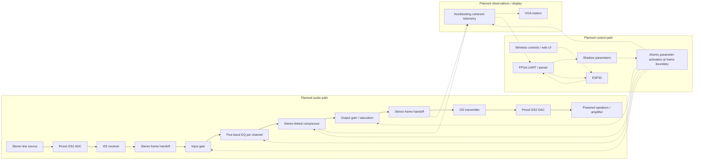

# ANIMA

**Artix Networked I2S Multiband Audio Processor** — Robel Yaee and An Tiet.

A planned Basys 3 / Pmod I2S2 stereo audio processor with ESP32 wireless controls. Nominal 48 kHz, signed 24-bit samples, two 32-bit I2S slots. Wi-Fi carries controls only.

**Current status:** Python preset/frame behavioral model, repository checks and [serial-timing](docs/implemented.md#serial-timing-component), [warm-reset controller](docs/implemented.md#warm-reset-controller), [I2S receiver](docs/implemented.md#i2s-receiver), [RX frame queue](docs/implemented.md#rx-frame-queue), [frame scheduler](docs/implemented.md#frame-scheduler) and [I2S transmitter](docs/implemented.md#i2s-transmitter) RTL components with passing simulation checks. Short component-chain simulation only; no accepted bypass build, firmware, synthesis target, routed timing or hardware audio validation. First audio milestone: stereo bypass without DSP. Basys 3 D.1 is on hand; the intended Pmod has not yet been purchased.

## Read the project

| Document | What belongs there |
| --- | --- |
| [Planning & Design](docs/planning.md) | Contracts, hardware, clocks, DSP/control proposals, acceptance requirements, ownership, open decisions and sources |
| [Implemented & Verified](docs/implemented.md) | Current code, checks actually run, tool evidence, reproducible commands and limitations |

The [source register](docs/planning.md#source-register) retains stable source IDs. Selected requirements are distinct from proposals and verified behavior.

## Planned system

This describes the planned final system, not implemented audio. Solid arrows carry audio; dashed arrows carry controls or observations. The first milestone implements only RX → coherent stereo frames → TX.



## Run current checks

With Python 3.12, from the repository root:

```sh
python scripts/check_repo.py
python -B -m unittest discover -s sim/fpga_control_logic -v
```

These check repository integrity and the Python behavioral model, not audio, FPGA timing or hardware. See [reproduction and evidence](docs/implemented.md#reproduce-current-checks).
